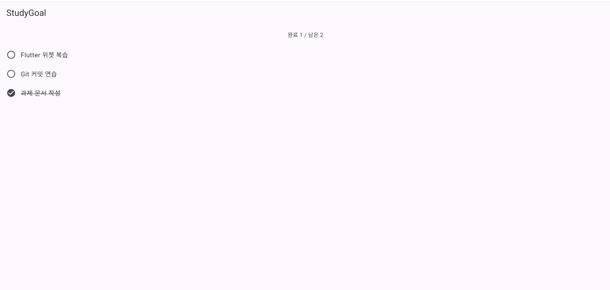
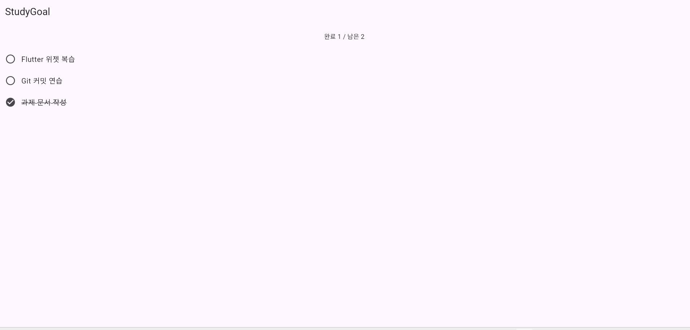

# week05_state_lab

A new Flutter project.

5주차 Flutter 상태 기능과 작업 컨텍스트 문서화 보고서

## 1. 상태 기능과 정적 분석

- 기능: StudyGoal 완료·취소 토글 + 완료 개수 표시
- 코드: `lib/main.dart`
- 실행 명령: `flutter run -d chrome`
- 정적 분석: `flutter analyze` 결과 `No issues found!`
- 상태 설계: 원본 상태 `goals`는 `_HomeScreenState`가 소유하고, `completedCount`와 `remainingCount`는 저장하지 않고 getter로 계산

## 2. 실행 화면

| 구분 | 확인 내용 | 인수 조건 | 화면 |
|---|---|---|---|
| 초기 | 완료 1 / 남은 2 | AC1 |  |
| 변경 | 항목 탭 후 완료 2 / 남은 1 | AC2 |  |
| 원복 | 같은 항목 재탭 후 완료 1 / 남은 2 | AC3 |  |

## 3. GitHub 저장소와 commit

- 본인 소유 저장소 링크: https://github.com/chuns3hun/week05_state_lab
- 기능·문서 최초 Commit ID: 8fc46cd
- Commit 메시지: feat: document state and task context
- 문서 파일: `STATE_CONTRACT.md`, `STATE_FLOW.md`, `CONTEXT_MAP.md`, `CONTEXT_PACKET.md`, `PROMPT_COMPARISON.md`

## 4. 학습기록

| 항목 | 작성 내용 |
|---|---|
| 목표 | 완료·취소 상태 기능을 구현하고, 상태 계약과 작업 컨텍스트 문서를 만들어 AI 요청 A/B를 같은 기준으로 비교하는 것을 목표로 했습니다. |
| 관찰 | 문장만 보낸 요청 A의 응답은 실제 프로젝트와 이름이 달랐고(StudyGoalScreen, _goals, isCompleted) 요청하지 않은 Checkbox·색상 변경이 있었습니다. 컨텍스트를 함께 보낸 요청 B의 응답은 실제 이름(HomeScreen, goals, isDone)과 일치했습니다. 또한 문서를 메모장에 붙여 넣은 뒤 줄 앞에 백슬래시 기호와 줄 사이 빈 줄이 생긴 것을 관찰했습니다. |
| 원인 | B는 입력에 완성된 main.dart가 포함되어 있어 응답이 입력 코드와 거의 같았습니다. 따라서 컨텍스트가 코드 품질을 높였다고 결론 내릴 수 없습니다. 백슬래시는 붙여 넣기 과정의 서식 변환으로 추정되며 정확한 원인은 확인 불가입니다. |
| 행동 | PowerShell 명령으로 백슬래시와 빈 줄을 제거하고 깨진 글자 개수를 확인한 뒤 다시 commit·push했습니다. |
| 결과 | 깨진 글자 0개를 확인했고, GitHub에서 흐름도와 표가 정상으로 표시되는 것을 확인했습니다. 요청 A/B 응답 코드는 실행하지 않았고 flutter analyze도 돌리지 않아 동작은 미확인으로 기록했습니다. |
| 다음 | 요청 A/B 응답 코드를 실제로 실행하고 flutter analyze로 검증해 미확인 항목을 확인할 예정입니다. |

## 5. 제출 설명

**1. 누가 상태를 소유하는가**

원본 상태 `goals`(`List<StudyGoal>`, 필드 title·isDone)는 `lib/main.dart`의 `_HomeScreenState`가 소유합니다. 완료·남은 개수(`completedCount`, `remainingCount`)는 저장하지 않고 getter로 `goals`에서 계산합니다.

**2. AI에게 어떤 자료를 왜 제공했는가**

요청 B에는 `CONTEXT_PACKET.md`와 `lib/main.dart` 전체를 제공했습니다. 실제 파일명·클래스명·제약을 알려 주기 위해서입니다. 다만 B 입력에 완성된 코드가 포함되어 있어 맥락이 코드 품질을 높였다고 결론 내릴 수는 없습니다. 두 응답 모두 실행하지 않았고 flutter analyze도 돌리지 않아 동작은 미확인입니다.

**3. 실행 증거가 어느 AC를 확인하는가**

`evidence/01_initial.png`는 AC1, `02_changed.png`는 AC2, `03_restored.png`는 AC3을 확인합니다. flutter analyze의 No issues found는 `lib/main.dart`에 분석 오류가 없다는 것만 확인합니다. AC4는 코드의 getter와 `STATE_CONTRACT.md`로 확인합니다.

**4. 다음 수정에 무엇을 다시 읽어야 하는가**

상태 로직을 고칠 때는 `STATE_CONTRACT.md`와 `lib/main.dart`의 `_HomeScreenState`를, 화면을 고칠 때는 `lib/main.dart`의 `build` 메서드를 다시 읽습니다 (`CONTEXT_MAP.md` 기준).